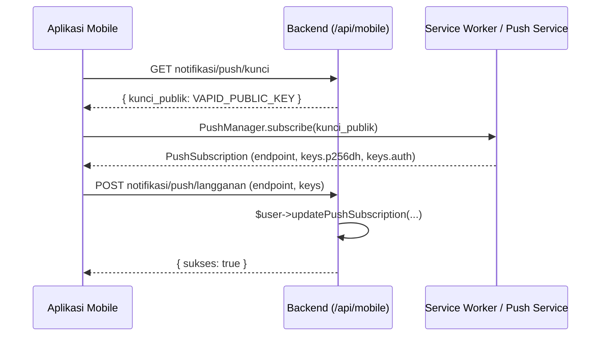
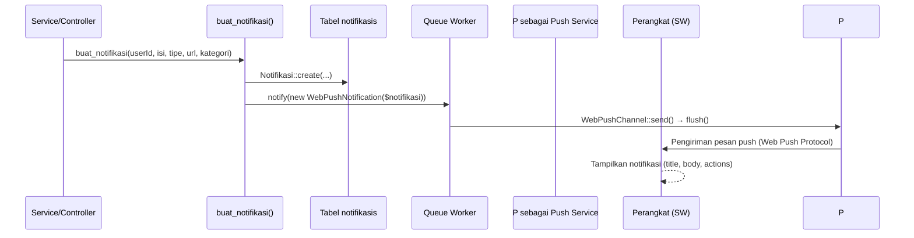

# Sistem Notifikasi Web Push

Dokumen ini menjelaskan cara kerja notifikasi web push di backend-absensi menggunakan paket [`laravel-notification-channels/webpush`](https://github.com/laravel-notification-channels/webpush) (v13.0.1) yang di atas [`minishlink/web-push`](https://github.com/web-push-libs/web-push-php) (v11.0.0).

---

## Daftar Isi

1. [Ringkasan Arsitektur](#1-ringkasan-arsitektur)
2. [Komponen Utama](#2-komponen-utama)
3. [Konfigurasi VAPID & Webpush](#3-konfigurasi-vapid--webpush)
4. [Endpoint API Mobile](#4-endpoint-api-mobile)
5. [Cara Notifikasi Dikirim](#5-cara-notifikasi-dikirim)
6. [Isi Payload Push](#6-isi-payload-push)
7. [Diagram Alur](#7-diagram-alur)
8. [Catatan & Jebakan](#8-catatan--jebakan)

---

## 1. Ringkasan Arsitektur

Sistem notifikasi ini terdiri dari dua bagian yang saling terhubung:

- **Notifikasi in-app (database)** — setiap notifikasi disimpan ke tabel `notifikasis` dan ditampilkan sebagai lonceng di navbar admin (Blade) serta lewat endpoint API mobile (`GET /api/mobile/notifikasi`).
- **Web push (perangkat)** — notifikasi yang sama juga dikirim ke perangkat pengguna melalui Web Push Protocol (HTTPS ke push service browser seperti FCM/APNs) menggunakan channel `WebPushChannel`.

Alur singkatnya:

```
Aplikasi (service/controller)
        │
        ▼
buat_notifikasi()  ──►  simpan baris ke tabel notifikasis
        │
        ▼
$user->notify(new WebPushNotification($notifikasi))   (via queue)
        │
        ▼
WebPushChannel  ──►  minishlink/web-push  ──►  Push Service (FCM dsb.)
        │
        ▼
Service Worker di perangkat  ──►  tampilkan notifikasi ke user
```

Push hanya aktif jika user pernah melakukan **subscribe** (langganan) dari aplikasi mobile-nya; langganan ini disimpan di tabel `push_subscriptions`.

---

## 2. Komponen Utama

### 2.1 `App\Models\Notifikasi` — model notifikasi in-app

- Tabel: `notifikasis`
- Kolom: `user_id`, `isi`, `is_read`, `url`, `tipe` (enum: `info`/`warning`/`danger`/`success`), `kategori`, timestamps.
- `kategori` bernilai salah satu dari `Notifikasi::KATEGORI`: `password`, `keamanan`, `jadwal`, `izin`, `lembur`, `sistem` (atau null → "Umum").
- Method penting:
  - `labelKategori()` — mengembalikan label human-readable dari `kategori` (dipakai sebagai judul push).
  - `scopeBelumDibaca()` — filter `is_read = false`.

### 2.2 `App\Models\User` — pemilik langganan push

```php
use Illuminate\Notifications\Notifiable;
use NotificationChannels\WebPush\HasPushSubscriptions;

class User extends Authenticatable
{
    use HasFactory, SoftDeletes, Notifiable, HasPushSubscriptions;
}
```

Trait `HasPushSubscriptions` (dari paket) menyediakan:

| Method | Fungsi |
|---|---|
| `pushSubscriptions()` | Relasi morphMany ke tabel `push_subscriptions` |
| `updatePushSubscription($endpoint, $key, $token, $encoding)` | Simpan/update langganan push |
| `deletePushSubscription($endpoint)` | Hapus langganan berdasarkan endpoint |
| `routeNotificationForWebPush()` | Mengembalikan collection langganan push untuk dikirim |
| `ownsPushSubscription($subscription)` | Cek apakah langganan milik user ini |

### 2.3 `NotificationChannels\WebPush\PushSubscription` — model vendor

Tidak ada model custom di `app/Models/`; model dipakai langsung dari paket. Kolom tabel `push_subscriptions`:

| Kolom | Keterangan |
|---|---|
| `id` | Big increment |
| `subscribable_type` / `subscribable_id` | Polymorphic ke `User` |
| `endpoint` | URL endpoint push perangkat, **unique**, charset ascii, maks 1024 karakter |
| `public_key` | Kunci `p256dh` dari browser |
| `auth_token` | Kunci `auth` dari browser |
| `content_encoding` | Encoding (mis. `aes128gcm`) |
| `timestamps` | |

### 2.4 `App\Notifications\WebPushNotification` — kelas notifikasi push

- File: `app/Notifications/WebPushNotification.php`
- Channel: hanya `WebPushChannel::class`
- **Mengimplementasikan `ShouldQueue`** — pengiriman dijadwalkan ke queue (lihat [Catatan & Jebakan](#8-catatan--jebakan)).
- Konstruktor menerima satu model `Notifikasi`, lalu `toWebPush()` menerjemahkannya menjadi `WebPushMessage` (lihat [Isi Payload Push](#6-isi-payload-push)).

### 2.5 Migrasi terkait

| File migrasi | Fungsi |
|---|---|
| `2026_08_22_112116_create_notifikasis_table.php` | Tabel `notifikasis` |
| `2026_10_03_000002_add_kategori_to_notifikasis_table.php` | Kolom `kategori` + index (`user_id`,`kategori`) dan (`user_id`,`is_read`) |
| `2026_10_17_134721_create_push_subscriptions_table.php` | Tabel `push_subscriptions` |
| `2026_10_17_134721_increase_push_subscriptions_endpoint_length.php` | Perluas kolom `endpoint` dari 500 ke 1024 |

> **Catatan:** project ini **tidak** memakai tabel `notifications` bawaan Laravel (channel `database` tidak digunakan). Tabel in-app notifications-nya sendiri adalah `notifikasis`.

---

## 3. Konfigurasi VAPID & Webpush

### 3.1 `config/webpush.php`

```php
return [
    'vapid' => [
        'subject'   => env('VAPID_SUBJECT'),
        'public_key' => env('VAPID_PUBLIC_KEY'),
        'private_key' => env('VAPID_PRIVATE_KEY'),
        'pem_file'  => env('VAPID_PEM_FILE'),
    ],
    'model' => PushSubscription::class,
    'table_name' => env('WEBPUSH_DB_TABLE', 'push_subscriptions'),
    'database_connection' => env('WEBPUSH_DB_CONNECTION', env('DB_CONNECTION', 'mysql')),
    'client_options' => [],
    'automatic_padding' => env('WEBPUSH_AUTOMATIC_PADDING', true),
];
```

### 3.2 Variabel environment

| Variabel | Fungsi | Nilai saat ini |
|---|---|---|
| `VAPID_PUBLIC_KEY` | Kunci publik VAPID — dibagikan ke aplikasi mobile untuk subscribe | terisi di `.env` |
| `VAPID_PRIVATE_KEY` | Kunci privat VAPID — dipakai backend menandatangani permintaan push | terisi di `.env` |
| `VAPID_SUBJECT` | Kontak penanggung jawab (mis. `mailto:admin@example.com`) | **belum di-set** di `.env` (fallback ke `url('/')`) |
| `WEBPUSH_DB_TABLE` | Nama tabel langganan | default `push_subscriptions` |
| `WEBPUSH_DB_CONNECTION` | Koneksi DB tabel langganan | default koneksi utama |

### 3.3 Membuat kunci VAPID

Generate kunci VAPID sekali (jangan di-commit):

```bash
php artisan webpush:vapid
```

Command ini men-generate pasangan kunci → masukkan hasilnya ke `VAPID_PUBLIC_KEY` dan `VAPID_PRIVATE_KEY` di `.env`.

> ⚠️ `.env.example` saat ini **belum memuat variabel VAPID sama sekali**. Developer baru harus menambahkannya manual (lihat [Catatan & Jebakan](#8-catatan--jebakan)).

---

## 4. Endpoint API Mobile

Semua endpoint berada di prefix `/api/mobile` dan dilindungi middleware `mobile.auth` (autentikasi via cookie `auth_token` → model `ApiToken`).

### 4.1 Ambil kunci publik VAPID

```
GET /api/mobile/notifikasi/push/kunci
```

Response:

```json
{
  "sukses": true,
  "kunci_publik": "BL6aTKpCC_qkw_rJ-..."
}
```

Aplikasi mobile memakai kunci ini saat melakukan `PushManager.subscribe()`.

### 4.2 Simpan / perbarui langganan push

```
POST /api/mobile/notifikasi/push/langganan
```

Body request (bentuk standar hasil `PushSubscription.toJSON()` dari browser):

```json
{
  "endpoint": "https://fcm.googleapis.com/...",
  "keys": {
    "p256dh": "BNx...",
    "auth": "aBc..."
  },
  "contentEncoding": "aes128gcm"
}
```

Response:

```json
{
  "sukses": true,
  "pesan": "Langganan push disimpan."
}
```

Endpoint diproses dengan `$user->updatePushSubscription(...)` → disimpan ke `push_subscriptions`. Karena kolom `endpoint` bersifat unique global, jika sebuah endpoint yang sama pernah dipakai user lain, baris milik user lain tersebut akan **dihapus** dan diganti milik user yang sedang login.

### 4.3 Batalkan langganan push

```
DELETE /api/mobile/notifikasi/push/langganan
```

Body request:

```json
{
  "endpoint": "https://fcm.googleapis.com/..."
}
```

Response:

```json
{
  "sukses": true,
  "pesan": "Langganan push dihapus."
}
```

### 4.4 Endpoint notifikasi in-app (terkait)

| Method | Endpoint | Fungsi |
|---|---|---|
| GET | `/api/mobile/notifikasi` | Daftar notifikasi user login |
| GET | `/api/mobile/notifikasi/total` | Total / jumlah belum dibaca |
| POST | `/api/mobile/notifikasi/baca-semua` | Tandai semua sudah dibaca |
| POST | `/api/mobile/notifikasi/{id}/baca` | Tandai satu notifikasi sudah dibaca |
| DELETE | `/api/mobile/notifikasi/{id}` | Hapus notifikasi |

---

## 5. Cara Notifikasi Dikirim

### 5.1 Helper `buat_notifikasi()` — satu-satunya pintu masuk push

Semua notifikasi (in-app + push) dibuat lewat helper global `buat_notifikasi()` di `app/Helpers/absensi.php` (di-autoload via `autoload.files` di `composer.json`):

```php
function buat_notifikasi(
    int $userId,
    string $isi,
    string $tipe = 'info',      // info|warning|danger|success
    ?string $url = null,        // deep-link target
    ?string $kategori = null,   // password|keamanan|jadwal|izin|lembur|sistem
): ?int
```

Alur di dalam helper:

1. Validasi argumen (`userId > 0` dan `isi` tidak kosong).
2. `Notifikasi::create(...)` — simpan baris ke tabel `notifikasis`.
3. `$baris->user?->notify(new WebPushNotification($baris))` — kirim web push. Karena `WebPushNotification` mengimplementasikan `ShouldQueue`, notifikasi masuk ke **queue** (kecuali `QUEUE_CONNECTION=sync`, lihat §8). Kegagalan push bersifat **non-fatal** (`try/catch` + `report($e)`).
4. Mengembalikan ID notifikasi, atau `null` jika gagal.

Terdapat juga `buat_notifikasi_banyak(iterable $userIds, ...)` yang memanggil `buat_notifikasi()` berulang untuk banyak user (misal ke semua admin).

### 5.2 Pemicu (call site) yang ada saat ini

| Lokasi | Kejadian | Penerima | `kategori` / `tipe` | `url` |
|---|---|---|---|---|
| `app/Services/PengajuanLemburService.php` | Pengajuan lembur baru | Atasan langsung | `lembur` / `warning` | `persetujuan` |
| `app/Services/PengajuanLemburService.php` | Pengajuan lembur baru (tanpa atasan) | Semua admin aktif | `lembur` / `warning` | `admin/lembur` |
| `app/Services/PengajuanLemburService.php` | Keputusan lembur (setujui/tolak) | Pemohon | `lembur` / `success`\|`danger` | `lembur` |
| `app/Services/UbahJadwalService.php` | Pengajuan ubah jadwal baru | Atasan langsung | `jadwal` / `warning` | `persetujuan` |
| `app/Services/UbahJadwalService.php` | Pengajuan ubah jadwal (tanpa atasan) | Semua admin aktif | `jadwal` / `warning` | `admin/jadwal_pengajuan` |
| `app/Services/UbahJadwalService.php` | Keputusan ubah jadwal | Pemohon | `jadwal` / `success`\|`danger` | `ubah-jadwal` |
| `app/Services/PasswordService.php` | Password diubah / diingatkan | User terkait | `password` / `success`\|`warning` | `null` |
| `app/Http/Controllers/Api/AuthController.php` | Registrasi user baru | Semua admin | `keamanan` / `warning` | route `admin.pegawai.index` |
| `app/Http/Controllers/Concerns/LaporResetDitolak.php` | Reset password ditolak (email belum verifikasi) | Semua admin aktif | `keamanan` / `warning` | `admin/aktivitas` |

Contoh pemakaian:

```php
// Kirim ke satu user
buat_notifikasi((int) $atasan->id, $isi, 'warning', 'persetujuan', 'lembur');

// Kirim ke banyak admin
buat_notifikasi_banyak($adminIds, $isi, 'warning', 'admin/aktivitas', 'keamanan');
```

### 5.3 In-app (admin panel)

Lonceng navbar admin (`resources/views/layouts/partials/navbar.blade.php`) memuat daftar notifikasi via `View::composer` di `app/Providers/AppServiceProvider.php` (`Notifikasi::where('user_id', session('uid'))->belumDibaca()`), dan menandai sudah dibaca lewat route admin:

- `POST admin/notifikasi/{id}/baca` → `admin.notifikasi.baca`
- `POST admin/notifikasi/baca-semua` → `admin.notifikasi.baca_semua`

---

## 6. Isi Payload Push

`WebPushNotification::toWebPush()` membangun pesan dari model `Notifikasi`:

```php
(new WebPushMessage)
    ->title($this->notifikasi->labelKategori() ?: 'Notifikasi')
    ->body($this->notifikasi->isi)
    ->icon('/favicon.svg')
    ->badge('/favicon.svg')
    ->tag('notif-' . $this->notifikasi->id)
    ->data([
        'url' => $url,
        'id' => $this->notifikasi->id,
        'kategori' => $this->notifikasi->kategori,
        'tipe' => $this->notifikasi->tipe,
    ])
    ->action('Buka', 'open')
    ->vibrate([200, 100, 200]);
```

Hasil JSON yang diterima service worker / aplikasi mobile:

```json
{
  "title": "Lembur",
  "body": "Pengajuan lembur baru menunggu persetujuan Anda.",
  "icon": "/favicon.svg",
  "badge": "/favicon.svg",
  "tag": "notif-42",
  "actions": [{ "title": "Buka", "action": "open" }],
  "vibrate": [200, 100, 200],
  "data": {
    "url": "/persetujuan",
    "id": 42,
    "kategori": "lembur",
    "tipe": "warning"
  }
}
```

### 6.1 Aturan normalisasi URL (`resolvePushUrl()`)

`data.url` dinormalisasi sebelum dikirim agar aman bagi service worker dan frontend:

| Input `url` | Hasil `data.url` |
|---|---|
| `null` / kosong / mengandung `..` / diawali `//` / mengandung skema URL (`https:` dll) | `/` |
| `lembur` | `/lembur` |
| `ubah-jadwal` | `/ubah-jadwal` |
| `persetujuan` | `/persetujuan` |
| diawali `admin/` | `/` (route admin tidak dibuka dari push mobile) |
| selain itu | diberi prefix `/` jika belum ada |

Tujuannya: mencegah open redirect, mencegah deep-link ke route admin dari perangkat mobile, dan menyeragamkan format path.

---

## 7. Diagram Alur

### 7.1 Subscribe (langganan push)



### 7.2 Kirim notifikasi



---

## 8. Catatan & Jebakan

### 8.1 Konfigurasi queue

- `WebPushNotification implements ShouldQueue` → pengiriman push berjalan di **queue**.
- `.env` saat ini: `QUEUE_CONNECTION=sync` → push dikirim **sinkron** di dalam request (blocking HTTP ke push service).
- `.env.example`: `QUEUE_CONNECTION=database` → butuh tabel `jobs`, tetapi **belum ada migrasi `jobs` / `failed_jobs`** di project ini. Jika beralih ke driver `database`, jalankan dulu:
  ```bash
  php artisan queue:table
  php artisan queue:failed-table
  php artisan migrate
  ```
  lalu jalankan worker: `php artisan queue:work` (atau `composer run dev` yang sudah menyertakan `queue:listen`).

### 8.2 Setup environment developer baru

- `.env.example` **tidak memuat** variabel `VAPID_*` sama sekali. Developer baru harus generate kunci (`php artisan webpush:vapid`) dan menambahkan `VAPID_PUBLIC_KEY` / `VAPID_PRIVATE_KEY` (dan sebaiknya `VAPID_SUBJECT`) secara manual, atau push akan gagal diam-diam (non-fatal, hanya muncul di log via `report()`).

### 8.3 Frontend / service worker bukan bagian repo ini

Repo ini **backend saja** — tidak ada file service worker (`sw.js`) maupun kode `pushManager` di `public/` atau `resources/`. Konsumen push adalah **aplikasi mobile terpisah** yang bertanggung jawab atas:

1. Mendaftarkan service worker dan melakukan `PushManager.subscribe()`.
2. Menangani event `push` (menampilkan notifikasi dari `data.title`/`body`/`dst. seperti §6) dan `notificationclick` (membuka `data.url`).
3. Mengirim hasil subscribe ke `POST /api/mobile/notifikasi/push/langganan`.

### 8.4 Langganan kadaluarsa / tidak valid

Paket ini menangani pengiriman yang gagal: jika push service mengembalikan status "expired" / "gone" (misal token FCM kedaluwarsa atau langganan dihapus dari sisi perangkat), `ReportHandler` bawaan paket **otomatis menghapus baris** `push_subscriptions` yang bersangkutan, sehingga tabel tidak menumpuk langganan mati.

### 8.5 Keamanan

- Endpoint `langganan`/`batalkan` dilindungi middleware `mobile.auth` — user hanya bisa mengelola langganan miliknya sendiri (`subscribable_id` = user login).
- Kolom `endpoint` unique global: satu endpoint perangkat hanya boleh terdaftar untuk satu user pada satu waktu.
- `resolvePushUrl()` membatasi `data.url` hanya untuk path lokal sehingga tidak membuka alamat eksternal / route admin dari notifikasi push.

### 8.6 Kelas yang tidak terpakai (dead code)

- `App\Notifications\PengajuanIzinNotification` — channel `mail`, **tidak dipanggil** di mana pun.
- `WhatsAppService::kirimNotifikasiIzin()` — juga tidak memiliki call site.
